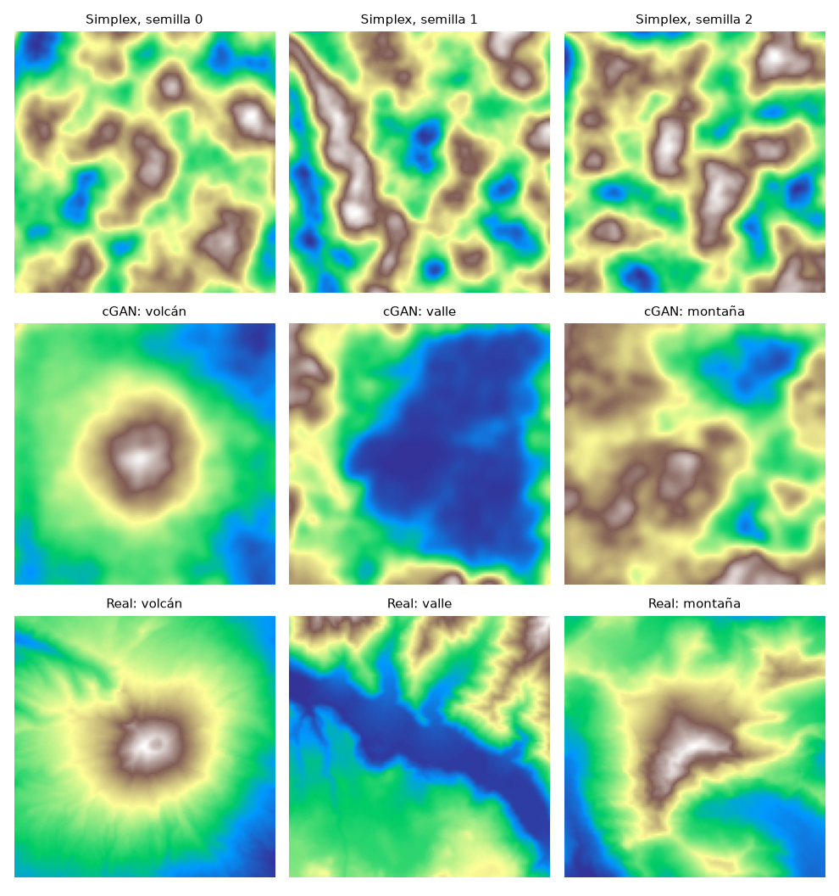

# Comparación contra la línea base Simplex

El anteproyecto planteó comparar la IA contra un generador clásico de ruido coherente (Simplex), que fue lo que se construyó en los Sprints 1 a 3. Esta comparación se hizo en el Sprint 10 con `python scrips/comparar_simplex.py`.

## Cómo se comparó

- **Simplex:** el mismo `fractal_noise_2d` del Sprint 3 (6 octavas, persistence 0.5, lacunarity 1.5). La escala 50 de 256 px se ajustó a 23.44 para 120 px, para que los rasgos midan lo mismo respecto al mapa. Se usaron 10 semillas.
- **cGAN:** el generador de la época 150, con 10 semillas por clase, sin suavizar (σ = 0) y con el suavizado del demo (σ = 2).
- **Real:** los 60 tiles SRTM del dataset, reducidos a 120×120 como en el entrenamiento.

En los tres casos cada mapa se normaliza por separado a [-1, 1], igual que en el entrenamiento, para que los números sean comparables.

Se midieron dos cosas:
- **Rugosidad:** la diferencia media de altura entre píxeles vecinos. Es la misma medida de la bitácora del Sprint 8. Un valor alto significa un terreno granulado o muy accidentado.
- **Variedad entre semillas:** la diferencia media entre cada par de mapas de la misma fuente. Un valor alto significa que cada semilla da un terreno distinto.

## Resultados

| Generador | Rugosidad | Variedad entre semillas |
| --- | --- | --- |
| Simplex (Sprint 3, sin clase) | 0.0402 | 0.453 |

| Clase | Tiles reales | Rugosidad real | cGAN σ=0 | cGAN σ=2 | Variedad real | Variedad cGAN σ=2 |
| --- | --- | --- | --- | --- | --- | --- |
| llanura | 9 | 0.0891 | 0.1294 | 0.0187 | 0.443 | 0.395 |
| lomas | 12 | 0.0363 | 0.0853 | 0.0208 | 0.530 | 0.598 |
| valle | 8 | 0.0281 | 0.0841 | 0.0222 | 0.512 | 0.552 |
| montaña | 14 | 0.0278 | 0.0932 | 0.0203 | 0.508 | 0.500 |
| meseta | 8 | 0.0313 | 0.0990 | 0.0222 | 0.622 | 0.598 |
| volcán | 9 | 0.0177 | 0.0741 | 0.0145 | 0.294 | 0.208 |

## Lectura

1. **En variedad no hay ganador.** El Simplex (0.45) queda dentro del rango del terreno real (0.29 a 0.62), y la cGAN se mueve en un rango parecido según la clase (0.21 a 0.60). Los dos generan mapas distintos con cada semilla.
2. **La diferencia está en el control y la forma.** El Simplex no recibe una clase: con cualquier semilla produce el mismo tipo de manchas, sin conos ni cuencas. La cGAN genera la forma que se le pide, y en la figura el volcán y el valle se parecen a los reales. Además respeta el orden real de suavidad: el volcán es la clase más lisa tanto en los datos reales (0.0177) como en la cGAN (0.0145).
3. **Sin suavizar, la cGAN es más granulada que el terreno real.** Con σ = 0 su rugosidad es de 1.5 a 4 veces la real; con σ = 2 queda un poco por debajo. Esto confirma con números lo que se vio en 3D: el suavizado del demo hace falta y no borra el relieve.
4. **La llanura es un caso especial.** Su rugosidad real es alta (0.089) porque, al normalizar cada tile a [-1, 1], el poco relieve de una llanura se estira y su ruido fino se amplifica. La cGAN con σ = 2 la deja mucho más lisa.

## Limitaciones

- La rugosidad y la variedad no miden "realismo" por sí solas. La forma se juzga en la figura, que es una comparación visual.
- Los tiles reales incluyen los de entrenamiento, así que el parecido de la cGAN con ellos no prueba que generalice a terrenos que nunca vio.
- Solo se probó la configuración del Simplex del Sprint 3; otra configuración daría otra rugosidad.
