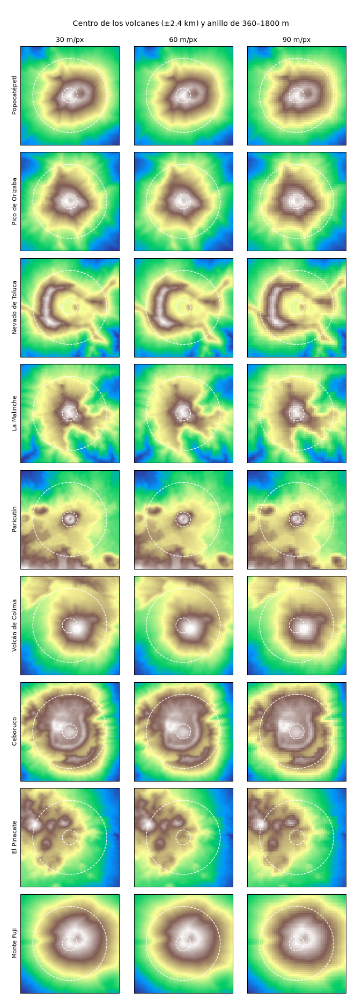
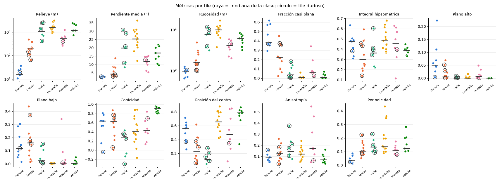
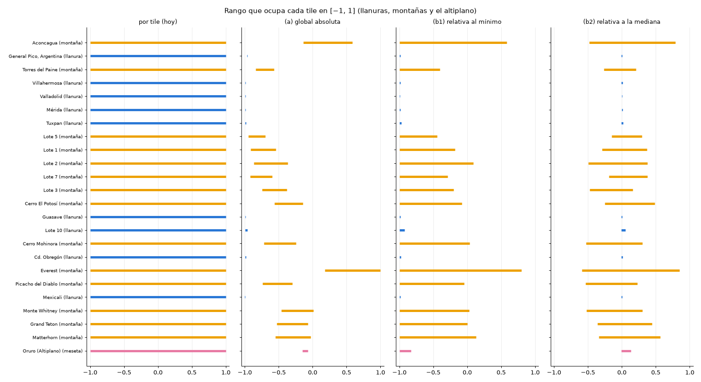

# Dataset v3: decisiones de datos (v1.2.0, paso 1)

Análisis hecho solo con los 60 tiles que ya están en `data/raw/`, sin descargar nada. Todas las tablas salen de `python scrips/analizar_dataset_v3.py` (salida completa en el anexo) y las gráficas están en `docs/img/dataset_v3/`. Las cifras que no salen del script son cálculos que se muestran aquí mismo.

## Decisiones tomadas (Fernando, 12/11/2026)

| Tema | Decisión |
|---|---|
| Escala | **60 m/px** (tiles de 180 px, promedio 2 × 2) |
| Criterio por clase | **Se adoptan las 6 reglas**, con los umbrales recalculados a 60 m (sección B5) |
| Meseta | **El dataset v3 debe traer más tiles de meseta claros**: cima plana y bordes abruptos dentro del recuadro. Hoy solo 3 de 8 cumplen la regla. |
| Cañón (id 6) y duna (id 7) | **Se aceptan**, con las reglas candidatas de B3b, sujetas a validación con tiles reales |
| Normalización | **(b2), relativa a la mediana, con S = 2500 m** |

Lo que sigue de este documento es el análisis con el que se tomaron estas decisiones.

---

## A. Escala: 60 o 90 m/px

### A1. Cráteres

**Método.** Es el mismo de la v1.0: profundidad = máximo del anillo menos el centro. Primero se comprobó qué entendía la v1.0 por "centro": el anillo se mide desde el centro geométrico del mapa (59.5 en 120 px) y el valor del centro es el promedio de los 2 × 2 píxeles centrales. Con esa lectura, a 90 m salen exactamente los números de la bitácora: Toluca +435, Pinacate +227, Colima +166 y Ceboruco +52 m.

**Escalado del anillo.** En la v1.0 el anillo iba de 4 a 20 px a 90 m, es decir, de 360 a 1800 m. Se mantuvo esa distancia en metros y se convirtió a píxeles con el tamaño de píxel de cada escala: 12–60 px a 30 m, 6–30 px a 60 m y 4–20 px a 90 m.

| Volcán | 30 m | 60 m | 90 m |
|---|---|---|---|
| Popocatépetl | −91 | −99 | −87 |
| Pico de Orizaba | +34 | +20 | +1 |
| Nevado de Toluca | +460 | +450 | +435 |
| La Malinche | −99 | −109 | −116 |
| Paricutín | −14 | −27 | −40 |
| Volcán de Colima | +170 | +169 | +166 |
| Ceboruco | +55 | +55 | +52 |
| El Pinacate | +231 | +225 | +227 |
| Monte Fuji | −11 | −5 | −4 |

Profundidad en metros. **Recuento:** con 100 m o más de profundidad, 3 de 9 en las tres escalas; con 50 m o más, 4 de 9 en las tres.

**Lectura: la escala no cambia el recuento.** Pasar de 90 a 60 m no rescata ningún cráter. La razón está en el propio método, no en la resolución:

- El anillo empieza a 360 m del centro. Un cráter cuyo borde está más cerca queda dentro del hueco del anillo y no se mide.
- El anillo se centra en el centro del tile, no en la cima.

En `crater_escalas.png` se ve el cráter del Popocatépetl como una mancha oscura fuera del centro y dentro del círculo interior. Algo parecido pasa con Paricutín, cuyo cono no domina el centro (ya estaba pendiente para la v1.2.0).

Si los cráteres pequeños importan, hace falta otro método, centrado en la cima y con un anillo más chico. Ese método sí dependería de la escala. No se aplicó porque no se pidió; queda como propuesta.

### A2. Recortes de 128 px

**Tamaño real del píxel.** El píxel nativo mide 30.7 a 30.9 m de norte a sur, pero de este a oeste va de 19.5 a 30.8 m, porque se angosta con la latitud. Por eso "60 m/px" solo es exacto de norte a sur. Un tile de 0.1° mide 11.06 a 11.12 km de norte a sur.

| | 90 m/px | 60 m/px |
|---|---|---|
| Tamaño del tile | 120 px | 180 px |
| Un recorte de 128 px cubre | 11.52 km | 7.68 km |
| ¿Cabe en el tile? | **No**: faltan 8 px | Sí |
| Recortes sin solape | 0 | **1** |
| Posiciones distintas posibles | — | (180 − 128 + 1)² = **2809** |
| Rejilla fija con paso de 52 px | — | **4** (2 × 2), con un solape de 76 px (59 %) |

A 90 m, para que entre un recorte de 128 habría que descargar tiles de al menos 11.52 km, es decir, de unos 0.104° (11.52 / 11.06 × 0.1). La otra salida sería entrenar con recortes más chicos.

### A3. Costos de cada escala

**Lo que se pierde al promediar** (la tabla completa está en el anexo):

- **El relieve casi no cambia.** A 60 m se conserva entre el 99.3 y el 100 % (mediana por clase); a 90 m, entre el 96.3 y el 100 %. Al máximo se le pierden, en el peor caso, 26 m a 60 m y 37 m a 90 m.
- **La pendiente es lo que más se pierde**, y la diferencia entre escalas es grande:

| Clase | Pendiente media conservada a 60 m | a 90 m |
|---|---|---|
| llanura | 58.7 % | 38.4 % |
| lomas | 81.7 % | 71.4 % |
| meseta | 91.5 % | 84.2 % |
| montaña | 96.2 % | 92.3 % |

  Las clases suaves (llanura y lomas) son las que más pierden. Son justo las que hoy se confunden.

**Memoria** (cálculo, en `float32`):

| | 60 m/px | 90 m/px |
|---|---|---|
| Datos de los 60 tiles | 60 × 180 × 180 × 4 B = 7.8 MB | 60 × 120 × 120 × 4 B = 3.5 MB |
| Con las 6 variantes por tile | 46.7 MB | 20.7 MB |

Las dos opciones son mínimas frente a 13.84 GiB de RAM. La línea base midió un pico de 0.75 GiB.

**Tiempo** (estimación, no medición): se supone que el costo es proporcional al número de píxeles, partiendo de la línea base de la v1.1.0 (4.93 s por época con 288 muestras de 120 × 120).

| Supuesto | Cálculo | s por época |
|---|---|---|
| Recortes de 128, mismo número de muestras | 4.93 × 128² / 120² = 4.93 × 1.138 | 5.6 |
| Rejilla de 4 recortes por tile (4 veces más muestras) | 5.6 × 4 | 22.4 |

El generador de la v1.4.0 será totalmente convolucional y cambiará el costo real, así que esto es solo el orden de magnitud. Se medirá con `scrips/medir_linea_base.py`.

**Territorio por mapa:** un mapa de 2048 px cubre 2048 × 60 = 122.9 km a 60 m, y 2048 × 90 = 184.3 km a 90 m.

**Descargas:** la fuente es SRTM a 30 m en los dos casos, así que la escala no cambia cuántas descargas hacen falta. Solo cambia el procesamiento.

### Recomendación A: 60 m/px

- Es la única escala en la que caben los recortes de 128 que pide la v1.4.0 sin cambiar el tamaño de los tiles.
- Conserva bastante más pendiente en las clases suaves (llanura 58.7 % contra 38.4 %), que son las que hoy se confunden.
- Cuesta poco: los datos pesan unos MB y, con las mismas muestras, la época es un 14 % más lenta.
- **Lo que no gana:** cráteres. Con el método actual no cambia nada.
- **Lo que cede:** para el mismo número de píxeles, cada mapa cubre 2/3 del territorio que cubriría a 90 m.

---

## B. Criterio medible por clase

### B1. Métricas

Se calcularon sobre el tile nativo (30 m), con el tamaño real del píxel en metros según la latitud.

| Métrica | Qué mide | Por qué |
|---|---|---|
| Relieve | percentil 99 − percentil 1, en m | la altura del accidente, sin que un píxel raro la infle |
| Pendiente media | en grados | qué tan empinado es |
| Rugosidad | diferencia media entre píxeles vecinos, en m | textura fina |
| Fracción casi plana | píxeles con pendiente < 2° | cuánto es plano |
| **Integral hipsométrica** (propuesta) | (media − p1) / (p99 − p1) | si la mayor parte del área está arriba (meseta, cañón) o abajo (valle) |
| **Plano alto / plano bajo** (propuesta) | píxeles planos en el 30 % superior o inferior del relieve | la cima plana de la meseta y el fondo plano del valle |
| **Conicidad** (propuesta) | correlación negativa entre la altura y la distancia a la cima | un cono baja parejo en todas direcciones |
| **Posición del centro** (propuesta) | altura relativa media del tercio central del tile | cada tile está centrado en el accidente elegido: un valle tiene el centro abajo y una montaña arriba |
| **Anisotropía** (propuesta) | 0 = laderas en todas direcciones; 1 = todas en una sola dirección | las dunas forman crestas paralelas |
| **Periodicidad** (propuesta) | fracción de la energía del espectro (la descomposición del terreno en ondas) que se lleva el pico más fuerte | las dunas se repiten a intervalos regulares |

Las cuatro métricas del pedido se ven en las primeras columnas. Las otras siete se proponen porque las cuatro básicas no separan valle de montaña ni meseta de lomas.

### B2. Rangos por clase y separación

En cada celda: mínimo / mediana / máximo.

| Métrica | llanura | lomas | valle | montaña | meseta | volcán | H |
|---|---|---|---|---|---|---|---|
| Relieve (m) | 11 / 16 / 37 | 66 / 196 / 478 | 371 / 1061 / 2497 | 934 / 1540 / 3049 | 262 / 533 / 1236 | 731 / 1173 / 2365 | 47.4 |
| Pendiente media (°) | 1.8 / 2.6 / 3.5 | 2.8 / 4.4 / 13.8 | 8.3 / 19.9 / 30.7 | 12.2 / 25.4 / 36.3 | 5.5 / 12.0 / 15.1 | 9.6 / 16.9 / 21.9 | 47.0 |
| Rugosidad (m) | 0.7 / 1.0 / 1.3 | 1.0 / 1.6 / 4.9 | 3.1 / 7.8 / 11.6 | 3.8 / 9.9 / 16.7 | 2.0 / 4.2 / 5.8 | 3.2 / 6.2 / 8.3 | 47.0 |
| Fracción casi plana | 0.29 / 0.38 / 0.62 | 0.02 / 0.22 / 0.45 | 0.01 / 0.04 / 0.18 | 0.00 / 0.01 / 0.06 | 0.02 / 0.06 / 0.34 | 0.00 / 0.01 / 0.07 | 44.0 |
| Posición del centro | 0.26 / 0.56 / 0.71 | 0.05 / 0.23 / 0.62 | 0.05 / 0.11 / 0.27 | 0.42 / 0.66 / 0.88 | 0.09 / 0.47 / 0.85 | 0.33 / 0.79 / 0.87 | 34.7 |
| Conicidad | −0.04 / 0.64 / 0.81 | 0.00 / 0.63 / 0.87 | −0.30 / 0.29 / 0.44 | −0.17 / 0.41 / 0.89 | 0.13 / 0.44 / 0.84 | 0.80 / 0.90 / 0.96 | 25.4 |

H es el estadístico de Kruskal-Wallis, una prueba que ordena los valores y mide qué tan separados quedan los grupos: más alto significa que la métrica ordena mejor a las 6 clases.

**Las que más separan** son relieve, pendiente y rugosidad (H ≈ 47; las tres miden casi lo mismo) y la fracción casi plana (44). Les sigue la posición del centro (34.7), que es la única que separa valle de montaña.

**Separaciones sin solape:**
- **Llanura y lomas, por relieve:** llanura llega a 37 m y lomas empieza en 66 m.
- **Valle y montaña, por posición del centro:** valle llega a 0.27 y montaña empieza en 0.42.
**Separación parcial:**
- **Volcán, por conicidad:** todos los volcanes dan 0.80 o más, pero también llegan ahí tiles de otras clases (lomas hasta 0.87, llanura 0.81, meseta 0.84 y montaña 0.89). Solo separa combinada con relieve ≥ 700 m, y aun así pasan dos montañas: Cerro El Potosí (0.89) y Lote 2 (0.88).

**Meseta no tiene ninguna métrica propia:** queda en medio en todas.

Las tablas completas (por tile y por clase con las 11 métricas) están en el anexo.

**Zonas de solapamiento.** Con todas las métricas juntas, se asigna cada tile a la clase cuyo centro (el promedio de sus métricas) le queda más cerca, calculado sin ese tile. Así coinciden 43 de 60.

De los 9 dudosos de `docs/dataset.md`:

| Tile dudoso | Etiqueta | Más cerca de |
|---|---|---|
| Lote 10 | llanura | lomas |
| Linares | lomas | llanura |
| Yosemite | valle | montaña |
| Lote 4 | meseta | volcán |
| Council Grove, Valle de Bravo, Chamonix, Lauterbrunnen y Lote 8 | — | su propia clase |

Además caen en zona de solapamiento 13 tiles que no estaban marcados como dudosos:

| Clase | Tiles |
|---|---|
| meseta | altiplano de Oruro, Monument Valley, Island in the Sky y Roraima |
| montaña | Torres del Paine y Cerro El Potosí |
| valle | Valle de Oaxaca y Napa |
| lomas | Prueba, Siena y Palouse |
| llanura | Tuxpan |
| volcán | Paricutín |

La lista completa, con la clase a la que quedan más cerca, está en el anexo.

### B3. Criterio propuesto (las 6 clases actuales)

Se aplica en este orden. Cada umbral sale de un hueco entre clases de la tabla B2:

1. **Llanura:** relieve < 50 m.
2. **Volcán:** conicidad ≥ 0.80, relieve ≥ 700 m y pendiente ≤ 22°.
3. **Valle:** posición del centro < 0.30 y relieve ≥ 500 m.
4. **Lomas:** relieve < 500 m.
5. **Montaña:** posición del centro ≥ 0.40 y pendiente ≥ 17°.
6. **Meseta:** el resto.

**Resultado sobre los 60 tiles:** coinciden 51.

| Clase | Aciertos | Errores |
|---|---|---|
| llanura | 9/9 | — |
| lomas | 12/12 | — |
| volcán | 9/9 | — |
| montaña | 12/14 | Torres del Paine sale meseta; Cerro El Potosí sale volcán |
| valle | 6/8 | Oaxaca y Valle de Bravo salen lomas (relieve < 500 m) |
| **meseta** | **3/8** | 4 salen lomas (altiplano, Lote 4, Monument Valley y Mesa Verde) y 1 valle (Pajarito) |

**Cuidado al leer el 51/60:**
- **Es optimista:** los umbrales se eligieron mirando estos mismos 60 tiles. Se sabrá cuánto vale de verdad con tiles nuevos.
- **Las pendientes se midieron a 30 m.** Con la escala elegida bajan (ver A3), así que los umbrales de pendiente deben recalcularse sobre los tiles a 60 o 90 m antes de usarlos.
- **Meseta es la clase débil.** Sus errores coinciden con lo que ya decía `dataset.md` del altiplano y de Lote 4. O la definición de meseta no se puede medir así a 11 km, o esos tiles no son mesetas en su recuadro. Es una decisión tuya, y cabe revisarla en la v1.3.0 con el etiquetador automático.

### B5. Criterio adoptado, a 60 m/px

Se recalcularon las métricas sobre los tiles promediados 2 × 2. Para que la conicidad mida lo mismo, su suavizado se mantuvo en ~150 m (2.5 px).

**Qué cambia:**
- **Pendientes:** bajan, y dos umbrales se ajustaron con el mismo criterio de antes (el entero siguiente al máximo de la clase vecina).
- **Conicidad:** el volcán con menos conicidad, Ceboruco, baja de 0.80 a 0.7985. Su umbral se ajustó con el criterio de la propuesta a 30 m: el mínimo de los volcanes redondeado hacia abajo.

| Regla | A 30 m (propuesta) | A 60 m (adoptado) | De dónde sale el umbral a 60 m |
|---|---|---|---|
| 1. Llanura | relieve < 50 m | igual | llanura llega a 37 m y lomas empieza en 65 m |
| 2. Volcán | conicidad ≥ 0.80, relieve ≥ 700 m, pendiente ≤ 22° | conicidad ≥ **0.79**, relieve ≥ 700 m, pendiente ≤ **21°** | conicidad mínima de los volcanes, 0.7985 (Ceboruco); pendiente máxima, 20.8° |
| 3. Valle | posición del centro < 0.30, relieve ≥ 500 m | igual | valles ≤ 0.27 y montañas ≥ 0.42; lomas llega a 475 m |
| 4. Lomas | relieve < 500 m | igual | — |
| 5. Montaña | posición del centro ≥ 0.40, pendiente ≥ 17° | posición del centro ≥ 0.40, pendiente ≥ **15°** | la meseta más empinada: 14.3° |
| 6. Meseta | el resto | igual | — |

**Resultado:** coinciden **51 de 60**, con los mismos 9 tiles que fallaban a 30 m:
- dos valles de relieve bajo (Oaxaca y Valle de Bravo);
- dos montañas (Torres del Paine y Cerro El Potosí);
- cinco mesetas.

Con 0.80 en lugar de 0.79, Ceboruco caía en meseta y el resultado era 50 de 60. Con 0.79 no entra ningún falso positivo nuevo. Los umbrales viven en `UMBRALES_60` de `scrips/analizar_dataset_v3.py`.

### B3b. Clases nuevas: cañón (id 6) y duna (id 7)

Aún no hay tiles de estas clases, así que **los criterios son hipótesis**. Lo único que se puede medir hoy es qué tiles actuales caerían en ellos por error.

**Cañón:** posición del centro < 0.30, relieve ≥ 500 m e integral hipsométrica ≥ 0.5.
- La idea: como un valle, pero con la mayor parte del área arriba, porque es una meseta cortada por un río.
- Entre los valles, la integral hipsométrica va de 0.22 a 0.41, salvo Yosemite (0.60).
- De los 60 tiles, **solo Yosemite** cae en esta regla. Es el mismo valle glaciar que la revisión manual describió como "parece cañón". El criterio apunta bien, pero un valle glaciar no es un cañón de río: con tiles reales de cañón habrá que decidir si Yosemite pasa a cañón o si hace falta otra métrica (por ejemplo, el ancho del fondo).

**Duna, separada de lomas** (la confusión que más preocupa):
- Las dos tienen relieve bajo y pendientes suaves; ni el relieve ni la pendiente las separan.
- Lo que cambia es la forma:
  - las dunas son crestas **paralelas** (anisotropía alta) que se **repiten** a intervalos regulares (periodicidad alta);
  - las lomas tienen una red de drenaje ramificada.
- **Regla candidata:** relieve < 500 m y (periodicidad > 0.2233 o anisotropía > 0.2597). Los umbrales son los máximos exactos de los 12 tiles de lomas, así que ninguna loma actual cae en la regla.
- **Falso positivo actual:** Mesa Verde (meseta, anisotropía 0.55). Una duna real debería tener además poca fracción plana y no tener bordes abruptos; eso se fija con tiles reales.
- **Métrica extra propuesta, sin calcular:** la fracción del área en depresiones cerradas. En las dunas hay hoyos entre crestas que no drenan; en las lomas el agua siempre tiene salida.

**Datos para validar (lugares candidatos, sin descargar):**
- **Duna:** Gran Desierto de Altar (Sonora, junto a El Pinacate), Médanos de Samalayuca (Chihuahua), Great Sand Dunes (Colorado), Namib, Erg Chebbi y Rub' al Khali.
- **Cañón:** Gran Cañón (Arizona), Barranca del Cobre (Chihuahua), Cañón del Sumidero (Chiapas), Cañón del Colca (Perú) y Fish River (Namibia).
- **Cómo validar:**
  - calcular las métricas de esos tiles con este mismo script;
  - comprobar que caen dentro de la regla y que ningún tile de las otras clases cae en ella;
  - dejar al menos uno de cada clase fuera del ajuste de umbrales, para medir el acierto sin trampa.
- **También revisar al descargar:**
  - si a 60 m la distancia entre crestas de cada campo de dunas ocupa varios píxeles; si no, la periodicidad no se puede medir;
  - que no haya píxeles sin dato.

---

## C. Normalización global

Sobre los tiles a 60 m:
- Elevación global de −20 a 8745 m.
- El relieve máximo de un tile es de 3595 m (Everest).
- La mayor distancia de un píxel a la mediana de su tile es de 2115 m.

**Variantes comparadas:**

| Variante | Fórmula | Escala |
|---|---|---|
| Por tile (hoy) | cada tile de su mínimo a su máximo → [−1, 1] | propia de cada tile |
| (a) Global absoluta | de −20 a 8745 m → [−1, 1] | global |
| (b1) Relativa al mínimo | (z − mínimo del tile) / S, llevado a [−1, 1] | S = 4000 m |
| (b2) Relativa a la mediana | (z − mediana del tile) / S | S = 2500 m |

**Qué pasa con cada una** (tabla completa en el anexo). La columna "1 m =" es cuánto mide en la escala de la red un escalón de 1 m de SRTM:

| | Por tile (hoy) | (a) | (b1) | (b2) |
|---|---|---|---|---|
| Llanuras: 1 m = | 0.013 a 0.12 | 0.00023 | 0.0005 | 0.0004 |
| Llanuras: rango que ocupan | todo [−1, 1] | franjas de 0.003 a 0.034 de ancho, pegadas a −1 | franjas de 0.008 a 0.076, pegadas a −1 | franjas de 0.007 a 0.061, alrededor de 0 |
| Montañas: rango | todo [−1, 1] | según su altitud (Everest +0.18 a +1.00; Torres del Paine −0.84 a −0.57) | de −1 hasta como mucho +0.80 | de −0.59 a +0.85, alrededor de 0 |
| Altiplano de Oruro (341 m de relieve) | todo [−1, 1] | −0.150 a −0.073 (por su altura de ~3.7 km) | −1.000 a −0.829 | −0.005 a +0.131 |

- **Por tile:** un escalón de 1 m mide hasta 0.12 en una llanura y 0.0006 en el Everest; es decir, una llanura muestra su ruido 200 veces aumentado. Ese es el problema actual.
- **(a):** obliga a la red a aprender la altitud absoluta, que no es forma. Además, la clase ya no se define por la forma: una llanura costera y el altiplano quedarían en lugares muy distintos de la escala.
- **(b1):** cada tile toca exactamente −1. Ahí la Tanh de salida del generador (la función que limita la salida entre −1 y 1) está saturada: aprende despacio cerca de los bordes, y el fondo de cada mapa tendría que caer justo en ese valor.
- **(b2):** el terreno queda alrededor de 0, donde la Tanh responde bien.
- **El altiplano**, con (b1) y (b2), se ve como un terreno ondulado de 341 m: la altitud se pierde. Es lo esperable si las clases son de forma; además, ese tile ya tenía el problema de que el recuadro deja fuera el borde de la meseta.

### Recomendación C: (b2), relativa a la mediana, con S = 2500 m

- **Mata la amplificación del ruido:** en una llanura, 1 m pasa de valer 0.013–0.12 a valer 0.0004.
- **Conserva la proporción real entre clases:** una llanura de 38 m y una montaña de 3164 m quedan en la misma escala.
- **Evita la zona saturada de la Tanh.**
- **Queda margen:** el peor tile actual llega a ±0.85.
- **Riesgo:** si un tile nuevo (un cañón profundo, por ejemplo) se aleja más de 2500 m de su mediana, se recorta. Hay que revisarlo con el dataset v3 completo y, si hace falta, subir S **antes** de entrenar. Cambiarla después obliga a reentrenar.

**Qué implica para la exportación en metros reales (v1.6.0):**
- **Por tile (hoy):** no se pueden recuperar metros, porque se pierde el relieve de cada tile. Por eso existe hoy la escala vertical por clase, ajustada a ojo, del visor.
- **Con (b2):** metros = salida × 2500 + altitud base.
  - El **relieve sale en metros reales directamente**; ya no hace falta la escala por clase.
  - La **altitud base** no la aprende la red: es un parámetro de exportación. Puede ser un valor por defecto por clase o el que elija el usuario.
- **Con (a):** los metros absolutos saldrían directos, pero a costa de que la red aprenda altitudes, que no es lo que define a las clases.

---

## Preguntas que se hicieron

Las respuestas están en "Decisiones tomadas", al inicio del documento.

1. **Escala:** 60 m/px (recomendada) o 90 m/px.
2. **Criterio por clase:**
   - ¿se adopta B3 como criterio inicial (umbrales recalculados a la escala elegida)?
   - ¿qué se hace con meseta (redefinirla, revisar sus 5 tiles que no cumplen o esperar a la v1.3.0)?
   - ¿se aceptan las reglas candidatas de cañón y duna, sujetas a validación con tiles reales?
3. **Normalización:** (b2) con S = 2500 m (recomendada), (b1) con S = 4000 m, (a) global absoluta, o seguir por tile.

---

## Anexo: salida completa de `scrips/analizar_dataset_v3.py`

<!-- Generado por scrips/analizar_dataset_v3.py sobre 60 tiles -->

### A1. Profundidad del cráter por escala

Anillo de 360 a 1800 m: 12–60 px a 30 m, 6–30 px a 60 m y 4–20 px a 90 m.

| Volcán | Tile | 30 m (m) | 60 m (m) | 90 m (m) |
|---|---|---|---|---|
| Popocatépetl | `dem_18.97_19.07_-98.68_-98.58` | -91 | -99 | -87 |
| Pico de Orizaba | `dem_18.98_19.08_-97.32_-97.22` | +34 | +20 | +1 |
| Nevado de Toluca | `dem_19.06_19.16_-99.81_-99.71` | +460 | +450 | +435 |
| La Malinche | `dem_19.18_19.28_-98.08_-97.98` | -99 | -109 | -116 |
| Paricutín | `dem_19.44_19.54_-102.3_-102.2` | -14 | -27 | -40 |
| Volcán de Colima | `dem_19.46_19.56_-103.67_-103.57` | +170 | +169 | +166 |
| Ceboruco | `dem_21.07_21.18_-104.56_-104.46` | +55 | +55 | +52 |
| El Pinacate | `dem_31.72_31.82_-113.53_-113.43` | +231 | +225 | +227 |
| Monte Fuji | `dem_35.31_35.41_138.68_138.78` | -11 | -5 | -4 |

- Con profundidad >= 100 m: 30 m → 3, 60 m → 3, 90 m → 3 de 9.
- Con profundidad >= 50 m: 30 m → 4, 60 m → 4, 90 m → 4 de 9.

### A2. Recortes de 128 px

- Píxel nativo norte-sur: 30.7 a 30.9 m; este-oeste: 19.5 a 30.8 m (se angosta con la latitud).
- Lado norte-sur de un tile de 0.1°: 11.06 a 11.12 km.
- A 60 m/px el tile mide 180 px; un recorte de 128 px cubre 7.68 km nominales.
  Sin solape caben 1. Con solape: posiciones distintas = (52 + 1)² = 2809; con paso de 52 px caben 2 × 2 = 4 (solape de 76 px, 59 %).
- A 90 m/px el tile mide 120 px; un recorte de 128 px cubre 11.52 km nominales.
  No cabe: faltan 8 px.

### A3. Lo que se pierde por el promedio (60 contra 90 m/px)

Respecto del tile nativo de 30 m. Relieve = percentil 99 menos percentil 1; la pendiente se recalcula con el píxel de cada escala.

| Clase | Pérdida de máximo a 60 m (m, mediana / peor) | a 90 m | Relieve conservado 60 m | 90 m | Pendiente media conservada 60 m | 90 m |
|---|---|---|---|---|---|---|
| llanura | 2 / 8 | 6 / 19 | 99.3 % | 96.3 % | 58.7 % | 38.4 % |
| lomas | 2 / 8 | 4 / 13 | 99.7 % | 99.6 % | 81.7 % | 71.4 % |
| valle | 7 / 18 | 9 / 32 | 100.0 % | 100.0 % | 94.1 % | 89.6 % |
| montaña | 3 / 26 | 8 / 37 | 100.0 % | 99.9 % | 96.2 % | 92.3 % |
| meseta | 3 / 22 | 6 / 30 | 99.9 % | 99.7 % | 91.5 % | 84.2 % |
| volcán | 7 / 12 | 14 / 21 | 100.0 % | 99.9 % | 94.5 % | 90.1 % |

### B1. Métricas por tile

Calculadas sobre el tile nativo (30 m nominales; el píxel real se toma de la latitud).

| Tile | Lugar | Clase | Relieve (m) | Pendiente media (°) | Rugosidad (m) | Fracción casi plana | Integral hipsométrica | Plano alto | Plano bajo | Conicidad | Posición del centro | Anisotropía | Periodicidad |
|---|---|---|---|---|---|---|---|---|---|---|---|---|---|
| `dem_-35.71_-35.61_-63.81_-63.71` | General Pico, Argentina | llanura | 16 | 1.9 | 0.7 | 0.58 | 0.48 | 0.11 | 0.14 | 0.64 | 0.71 | 0.10 | 0.034 |
| `dem_17.94_18.04_-93.0_-92.9` | Villahermosa | llanura | 24 | 2.3 | 0.9 | 0.47 | 0.33 | 0.03 | 0.30 | 0.53 | 0.65 | 0.07 | 0.074 |
| `dem_20.64_20.74_-88.25_-88.15` | Valladolid | llanura | 11 | 1.9 | 0.7 | 0.57 | 0.41 | 0.06 | 0.21 | 0.64 | 0.39 | 0.05 | 0.019 |
| `dem_20.92_21.02_-89.64_-89.54` | Mérida | llanura | 11 | 2.6 | 1.0 | 0.37 | 0.48 | 0.05 | 0.07 | 0.15 | 0.49 | 0.09 | 0.010 |
| `dem_20.9_21.0_-97.45_-97.35` | Tuxpan | llanura | 37 | 3.5 | 1.3 | 0.35 | 0.31 | 0.01 | 0.29 | 0.54 | 0.26 | 0.05 | 0.087 |
| `dem_25.52_25.62_-108.52_-108.42` | Guasave | llanura | 16 | 3.0 | 1.2 | 0.29 | 0.51 | 0.05 | 0.05 | 0.81 | 0.58 | 0.12 | 0.014 |
| `dem_25.77_25.88_-108.97_-108.88` | Lote 10 (dudoso) | llanura | 19 | 2.7 | 1.0 | 0.37 | 0.38 | 0.00 | 0.12 | -0.04 | 0.37 | 0.16 | 0.023 |
| `dem_27.44_27.54_-109.99_-109.89` | Cd. Obregón | llanura | 27 | 2.6 | 1.0 | 0.38 | 0.49 | 0.07 | 0.10 | 0.77 | 0.56 | 0.09 | 0.069 |
| `dem_32.57_32.67_-115.5_-115.4` | Mexicali | llanura | 15 | 1.8 | 0.7 | 0.62 | 0.63 | 0.22 | 0.02 | 0.65 | 0.61 | 0.06 | 0.051 |
| `dem_20.77_20.87_-102.81_-102.71` | Tepatitlán | lomas | 202 | 4.0 | 1.5 | 0.22 | 0.49 | 0.07 | 0.06 | 0.78 | 0.32 | 0.08 | 0.101 |
| `dem_21.11_21.21_-100.98_-100.88` | Dolores Hidalgo | lomas | 224 | 3.8 | 1.4 | 0.22 | 0.21 | 0.00 | 0.20 | 0.60 | 0.17 | 0.03 | 0.164 |
| `dem_23.18_23.28_-106.44_-106.34` | Lote 8 (dudoso) | lomas | 145 | 3.9 | 1.4 | 0.37 | 0.14 | 0.00 | 0.37 | 0.71 | 0.06 | 0.18 | 0.083 |
| `dem_23.27_23.38_-106.12_-106.03` | Lote 6 | lomas | 369 | 8.7 | 3.1 | 0.10 | 0.25 | 0.00 | 0.10 | 0.66 | 0.11 | 0.06 | 0.052 |
| `dem_23.52_23.62_-106.42_-106.33` | Prueba | lomas | 478 | 13.8 | 4.9 | 0.02 | 0.35 | 0.00 | 0.02 | 0.51 | 0.43 | 0.26 | 0.180 |
| `dem_24.77_24.88_-107.42_-107.33` | Lote 9 | lomas | 197 | 4.8 | 1.8 | 0.18 | 0.19 | 0.00 | 0.17 | 0.22 | 0.10 | 0.12 | 0.128 |
| `dem_24.81_24.91_-99.62_-99.52` | Linares, NL (dudoso) | lomas | 103 | 2.8 | 1.0 | 0.37 | 0.43 | 0.05 | 0.15 | 0.77 | 0.37 | 0.03 | 0.096 |
| `dem_32.03_32.13_-116.67_-116.57` | Valle de Guadalupe, BC | lomas | 384 | 8.3 | 2.8 | 0.23 | 0.24 | 0.00 | 0.23 | 0.00 | 0.05 | 0.22 | 0.149 |
| `dem_38.61_38.71_-96.54_-96.44` | Council Grove (Flint Hills), EE. UU. (dudoso) | lomas | 66 | 3.0 | 1.0 | 0.35 | 0.46 | 0.03 | 0.18 | 0.06 | 0.29 | 0.12 | 0.223 |
| `dem_43.27_43.37_11.28_11.38` | Siena, Italia | lomas | 176 | 8.1 | 2.5 | 0.07 | 0.48 | 0.01 | 0.04 | 0.87 | 0.62 | 0.14 | 0.073 |
| `dem_46.68_46.78_-117.23_-117.13` | Pullman (Palouse), EE. UU. | lomas | 112 | 5.9 | 1.8 | 0.10 | 0.59 | 0.02 | 0.02 | 0.32 | 0.43 | 0.09 | 0.080 |
| `dem_46.98_47.08_4.79_4.89` | Beaune, Francia | lomas | 195 | 3.7 | 1.1 | 0.45 | 0.26 | 0.01 | 0.44 | 0.80 | 0.13 | 0.13 | 0.108 |
| `dem_-13.36_-13.25_-72.17_-72.07` | Urubamba, Perú | valle | 1436 | 20.0 | 7.9 | 0.06 | 0.35 | 0.00 | 0.04 | 0.32 | 0.11 | 0.08 | 0.186 |
| `dem_17.01_17.11_-96.78_-96.68` | Valle de Oaxaca | valle | 371 | 8.3 | 3.1 | 0.11 | 0.22 | 0.00 | 0.11 | -0.07 | 0.10 | 0.12 | 0.102 |
| `dem_17.72_17.82_-96.37_-96.27` | Valle Nacional, Oaxaca | valle | 786 | 19.8 | 7.6 | 0.02 | 0.38 | 0.00 | 0.02 | -0.14 | 0.11 | 0.10 | 0.141 |
| `dem_19.14_19.25_-100.18_-100.08` | Valle de Bravo (dudoso) | valle | 416 | 10.9 | 4.0 | 0.18 | 0.41 | 0.00 | 0.15 | -0.30 | 0.15 | 0.10 | 0.093 |
| `dem_37.7_37.8_-119.64_-119.54` | Yosemite (dudoso) | valle | 1336 | 20.8 | 8.2 | 0.02 | 0.60 | 0.01 | 0.01 | 0.25 | 0.27 | 0.17 | 0.229 |
| `dem_38.46_38.56_-122.52_-122.42` | Napa (St. Helena) | valle | 703 | 11.1 | 3.7 | 0.14 | 0.23 | 0.00 | 0.14 | 0.44 | 0.05 | 0.24 | 0.126 |
| `dem_45.87_45.97_6.82_6.92` | Chamonix (dudoso) | valle | 2497 | 28.6 | 10.2 | 0.02 | 0.34 | 0.00 | 0.01 | 0.34 | 0.09 | 0.38 | 0.148 |
| `dem_46.54_46.64_7.86_7.96` | Lauterbrunnen (dudoso) | valle | 2405 | 30.7 | 11.6 | 0.01 | 0.39 | 0.00 | 0.00 | 0.36 | 0.20 | 0.21 | 0.107 |
| `dem_-32.7_-32.6_-70.06_-69.96` | Aconcagua | montaña | 2745 | 30.9 | 12.4 | 0.00 | 0.41 | 0.00 | 0.00 | 0.75 | 0.79 | 0.05 | 0.196 |
| `dem_-50.99_-50.89_-73.46_-73.36` | Torres del Paine | montaña | 977 | 12.2 | 3.8 | 0.06 | 0.57 | 0.01 | 0.00 | 0.03 | 0.63 | 0.20 | 0.099 |
| `dem_23.57_23.68_-106.02_-105.92` | Lote 5 | montaña | 934 | 20.3 | 7.4 | 0.00 | 0.37 | 0.00 | 0.00 | 0.55 | 0.42 | 0.07 | 0.363 |
| `dem_23.68_23.78_-105.92_-105.83` | Lote 1 | montaña | 1392 | 30.6 | 12.2 | 0.00 | 0.48 | 0.00 | 0.00 | 0.57 | 0.52 | 0.13 | 0.144 |
| `dem_23.77_23.88_-105.77_-105.67` | Lote 2 | montaña | 1923 | 28.5 | 11.4 | 0.01 | 0.52 | 0.01 | 0.00 | 0.88 | 0.61 | 0.18 | 0.139 |
| `dem_23.88_23.98_-106.22_-106.12` | Lote 7 | montaña | 1051 | 23.7 | 9.0 | 0.00 | 0.40 | 0.00 | 0.00 | 0.34 | 0.58 | 0.05 | 0.089 |
| `dem_23.97_24.07_-105.62_-105.53` | Lote 3 | montaña | 1260 | 25.8 | 10.5 | 0.01 | 0.67 | 0.01 | 0.00 | 0.24 | 0.44 | 0.12 | 0.100 |
| `dem_24.82_24.92_-100.27_-100.17` | Cerro El Potosí | montaña | 1679 | 17.9 | 6.4 | 0.01 | 0.38 | 0.00 | 0.01 | 0.89 | 0.63 | 0.10 | 0.434 |
| `dem_25.9_26.0_-107.08_-106.98` | Cerro Mohinora | montaña | 1767 | 23.4 | 8.8 | 0.00 | 0.61 | 0.00 | 0.00 | 0.35 | 0.88 | 0.07 | 0.123 |
| `dem_27.94_28.04_86.88_86.97` | Everest | montaña | 3049 | 36.3 | 16.7 | 0.01 | 0.45 | 0.00 | 0.00 | 0.69 | 0.79 | 0.24 | 0.222 |
| `dem_30.93_31.03_-115.47_-115.37` | Picacho del Diablo | montaña | 1467 | 21.7 | 8.4 | 0.02 | 0.68 | 0.02 | 0.00 | -0.17 | 0.81 | 0.16 | 0.124 |
| `dem_36.53_36.63_-118.34_-118.24` | Monte Whitney | montaña | 1493 | 27.2 | 10.6 | 0.02 | 0.64 | 0.00 | 0.00 | 0.45 | 0.81 | 0.10 | 0.136 |
| `dem_43.69_43.79_-110.85_-110.75` | Grand Teton | montaña | 1588 | 29.7 | 11.2 | 0.01 | 0.50 | 0.00 | 0.01 | 0.38 | 0.73 | 0.15 | 0.196 |
| `dem_45.93_46.03_7.61_7.71` | Matterhorn | montaña | 1767 | 25.0 | 9.2 | 0.01 | 0.44 | 0.00 | 0.01 | 0.18 | 0.68 | 0.14 | 0.347 |
| `dem_-18.01_-17.91_-67.16_-67.06` | Oruro (Altiplano) | meseta | 262 | 5.5 | 2.0 | 0.34 | 0.12 | 0.00 | 0.34 | 0.47 | 0.09 | 0.17 | 0.143 |
| `dem_24.18_24.28_-105.52_-105.42` | Lote 4 (dudoso) | meseta | 394 | 12.8 | 4.5 | 0.03 | 0.40 | 0.00 | 0.01 | 0.69 | 0.35 | 0.06 | 0.079 |
| `dem_35.83_35.93_-106.35_-106.25` | Meseta Pajarito, Los Álamos | meseta | 620 | 11.1 | 3.8 | 0.06 | 0.32 | 0.00 | 0.03 | 0.84 | 0.27 | 0.46 | 0.072 |
| `dem_36.95_37.05_-110.15_-110.05` | Monument Valley | meseta | 293 | 6.3 | 2.2 | 0.19 | 0.41 | 0.00 | 0.09 | 0.13 | 0.41 | 0.17 | 0.111 |
| `dem_37.13_37.23_-108.54_-108.44` | Mesa Verde | meseta | 484 | 15.1 | 5.2 | 0.06 | 0.57 | 0.01 | 0.00 | 0.64 | 0.54 | 0.55 | 0.083 |
| `dem_38.41_38.51_-109.87_-109.77` | Island in the Sky | meseta | 582 | 14.7 | 5.5 | 0.07 | 0.61 | 0.05 | 0.00 | 0.18 | 0.70 | 0.05 | 0.112 |
| `dem_39.01_39.11_-108.04_-107.94` | Grand Mesa | meseta | 655 | 10.0 | 3.3 | 0.08 | 0.63 | 0.03 | 0.00 | 0.37 | 0.84 | 0.32 | 0.130 |
| `dem_5.09_5.19_-60.81_-60.71` | Roraima | meseta | 1236 | 14.7 | 5.8 | 0.02 | 0.50 | 0.01 | 0.01 | 0.40 | 0.85 | 0.12 | 0.176 |
| `dem_18.97_19.07_-98.68_-98.58` | Popocatépetl | volcán | 2176 | 20.0 | 7.4 | 0.00 | 0.40 | 0.00 | 0.00 | 0.90 | 0.80 | 0.07 | 0.155 |
| `dem_18.98_19.08_-97.32_-97.22` | Pico de Orizaba | volcán | 2016 | 21.9 | 8.3 | 0.00 | 0.39 | 0.00 | 0.00 | 0.86 | 0.79 | 0.04 | 0.105 |
| `dem_19.06_19.16_-99.81_-99.71` | Nevado de Toluca | volcán | 1131 | 16.9 | 6.2 | 0.01 | 0.41 | 0.00 | 0.00 | 0.83 | 0.82 | 0.07 | 0.103 |
| `dem_19.18_19.28_-98.08_-97.98` | La Malinche | volcán | 1173 | 14.8 | 5.6 | 0.01 | 0.34 | 0.00 | 0.01 | 0.96 | 0.78 | 0.05 | 0.108 |
| `dem_19.44_19.54_-102.3_-102.2` | Paricutín | volcán | 1156 | 10.5 | 3.8 | 0.07 | 0.33 | 0.00 | 0.05 | 0.81 | 0.33 | 0.10 | 0.106 |
| `dem_19.46_19.56_-103.67_-103.57` | Volcán de Colima | volcán | 2186 | 20.9 | 7.8 | 0.00 | 0.45 | 0.00 | 0.00 | 0.93 | 0.68 | 0.08 | 0.201 |
| `dem_21.07_21.18_-104.56_-104.46` | Ceboruco | volcán | 1169 | 13.4 | 4.9 | 0.04 | 0.38 | 0.00 | 0.02 | 0.80 | 0.87 | 0.04 | 0.124 |
| `dem_31.72_31.82_-113.53_-113.43` | El Pinacate | volcán | 731 | 9.6 | 3.2 | 0.04 | 0.41 | 0.00 | 0.03 | 0.94 | 0.75 | 0.16 | 0.283 |
| `dem_35.31_35.41_138.68_138.78` | Monte Fuji | volcán | 2365 | 20.2 | 6.8 | 0.00 | 0.37 | 0.00 | 0.00 | 0.94 | 0.81 | 0.12 | 0.207 |

### B2. Mínimo / mediana / máximo por clase

| Métrica | llanura | lomas | valle | montaña | meseta | volcán | H de Kruskal-Wallis |
|---|---|---|---|---|---|---|---|
| Relieve (m) | 11 / 16 / 37 | 66 / 196 / 478 | 371 / 1061 / 2497 | 934 / 1540 / 3049 | 262 / 533 / 1236 | 731 / 1173 / 2365 | 47.4 |
| Pendiente media (°) | 1.8 / 2.6 / 3.5 | 2.8 / 4.4 / 13.8 | 8.3 / 19.9 / 30.7 | 12.2 / 25.4 / 36.3 | 5.5 / 12.0 / 15.1 | 9.6 / 16.9 / 21.9 | 47.0 |
| Rugosidad (m) | 0.7 / 1.0 / 1.3 | 1.0 / 1.6 / 4.9 | 3.1 / 7.8 / 11.6 | 3.8 / 9.9 / 16.7 | 2.0 / 4.2 / 5.8 | 3.2 / 6.2 / 8.3 | 47.0 |
| Fracción casi plana | 0.29 / 0.38 / 0.62 | 0.02 / 0.22 / 0.45 | 0.01 / 0.04 / 0.18 | 0.00 / 0.01 / 0.06 | 0.02 / 0.06 / 0.34 | 0.00 / 0.01 / 0.07 | 44.0 |
| Integral hipsométrica | 0.31 / 0.48 / 0.63 | 0.14 / 0.30 / 0.59 | 0.22 / 0.36 / 0.60 | 0.37 / 0.49 / 0.68 | 0.12 / 0.45 / 0.63 | 0.33 / 0.39 / 0.45 | 13.5 |
| Plano alto | 0.00 / 0.05 / 0.22 | 0.00 / 0.01 / 0.07 | 0.00 / 0.00 / 0.01 | 0.00 / 0.00 / 0.02 | 0.00 / 0.01 / 0.05 | 0.00 / 0.00 / 0.00 | 25.3 |
| Plano bajo | 0.02 / 0.12 / 0.30 | 0.02 / 0.16 / 0.44 | 0.00 / 0.03 / 0.15 | 0.00 / 0.00 / 0.01 | 0.00 / 0.01 / 0.34 | 0.00 / 0.00 / 0.05 | 36.0 |
| Conicidad | -0.04 / 0.64 / 0.81 | 0.00 / 0.63 / 0.87 | -0.30 / 0.29 / 0.44 | -0.17 / 0.41 / 0.89 | 0.13 / 0.44 / 0.84 | 0.80 / 0.90 / 0.96 | 25.4 |
| Posición del centro | 0.26 / 0.56 / 0.71 | 0.05 / 0.23 / 0.62 | 0.05 / 0.11 / 0.27 | 0.42 / 0.66 / 0.88 | 0.09 / 0.47 / 0.85 | 0.33 / 0.79 / 0.87 | 34.7 |
| Anisotropía | 0.05 / 0.09 / 0.16 | 0.03 / 0.12 / 0.26 | 0.08 / 0.15 / 0.38 | 0.05 / 0.12 / 0.24 | 0.05 / 0.17 / 0.55 | 0.04 / 0.07 / 0.16 | 11.4 |
| Periodicidad | 0.010 / 0.034 / 0.087 | 0.052 / 0.104 / 0.223 | 0.093 / 0.134 / 0.229 | 0.089 / 0.141 / 0.434 | 0.072 / 0.112 / 0.176 | 0.103 / 0.124 / 0.283 | 25.5 |

H más alto = la métrica ordena mejor a las 6 clases (prueba por rangos, robusta a valores extremos).

### B2b. Tiles en zona de solapamiento

Se asigna cada tile a la clase cuyo centro (promedio de métricas) le queda más cerca, calculando los centros sin ese tile. Si no coincide con su etiqueta, está en zona de solapamiento.

| Tile | Lugar | Etiqueta | Más cerca de | Dudoso en dataset.md |
|---|---|---|---|---|
| `dem_-18.01_-17.91_-67.16_-67.06` | Oruro (Altiplano) | meseta | lomas | no |
| `dem_-50.99_-50.89_-73.46_-73.36` | Torres del Paine | montaña | meseta | no |
| `dem_17.01_17.11_-96.78_-96.68` | Valle de Oaxaca | valle | lomas | no |
| `dem_19.44_19.54_-102.3_-102.2` | Paricutín | volcán | meseta | no |
| `dem_20.9_21.0_-97.45_-97.35` | Tuxpan | llanura | lomas | no |
| `dem_23.52_23.62_-106.42_-106.33` | Prueba | lomas | meseta | no |
| `dem_24.18_24.28_-105.52_-105.42` | Lote 4 | meseta | volcán | sí |
| `dem_24.81_24.91_-99.62_-99.52` | Linares, NL | lomas | llanura | sí |
| `dem_24.82_24.92_-100.27_-100.17` | Cerro El Potosí | montaña | volcán | no |
| `dem_25.77_25.88_-108.97_-108.88` | Lote 10 | llanura | lomas | sí |
| `dem_36.95_37.05_-110.15_-110.05` | Monument Valley | meseta | lomas | no |
| `dem_37.7_37.8_-119.64_-119.54` | Yosemite | valle | montaña | sí |
| `dem_38.41_38.51_-109.87_-109.77` | Island in the Sky | meseta | montaña | no |
| `dem_38.46_38.56_-122.52_-122.42` | Napa (St. Helena) | valle | lomas | no |
| `dem_43.27_43.37_11.28_11.38` | Siena, Italia | lomas | meseta | no |
| `dem_46.68_46.78_-117.23_-117.13` | Pullman (Palouse), EE. UU. | lomas | meseta | no |
| `dem_5.09_5.19_-60.81_-60.71` | Roraima | meseta | montaña | no |

Coinciden 43 de 60 tiles.

Los 9 dudosos de dataset.md:

- `dem_25.77_25.88_-108.97_-108.88` (Lote 10, llanura): más cerca de lomas (2.91), luego llanura (3.09).
- `dem_24.81_24.91_-99.62_-99.52` (Linares, NL, lomas): más cerca de llanura (1.79), luego lomas (2.34).
- `dem_38.61_38.71_-96.54_-96.44` (Council Grove (Flint Hills), EE. UU., lomas): más cerca de lomas (2.73), luego llanura (3.18).
- `dem_19.14_19.25_-100.18_-100.08` (Valle de Bravo, valle): más cerca de valle (2.66), luego lomas (2.93).
- `dem_45.87_45.97_6.82_6.92` (Chamonix, valle): más cerca de valle (2.93), luego meseta (3.39).
- `dem_46.54_46.64_7.86_7.96` (Lauterbrunnen, valle): más cerca de valle (2.16), luego montaña (2.50).
- `dem_37.7_37.8_-119.64_-119.54` (Yosemite, valle): más cerca de montaña (1.94), luego valle (2.66).
- `dem_24.18_24.28_-105.52_-105.42` (Lote 4, meseta): más cerca de volcán (2.09), luego valle (2.56).
- `dem_23.18_23.28_-106.44_-106.34` (Lote 8, lomas): más cerca de lomas (3.23), luego llanura (4.51).

### B3. Criterio candidato aplicado a los 60 tiles

| Etiqueta \ Regla | llanura | lomas | valle | montaña | meseta | volcán |
|---|---|---|---|---|---|---|
| llanura | 9 | 0 | 0 | 0 | 0 | 0 |
| lomas | 0 | 12 | 0 | 0 | 0 | 0 |
| valle | 0 | 2 | 6 | 0 | 0 | 0 |
| montaña | 0 | 0 | 0 | 12 | 1 | 1 |
| meseta | 0 | 4 | 1 | 0 | 3 | 0 |
| volcán | 0 | 0 | 0 | 0 | 0 | 9 |

Coinciden 51 de 60. No coinciden:

- `dem_17.01_17.11_-96.78_-96.68` (Valle de Oaxaca): etiqueta valle, la regla dice lomas.
- `dem_19.14_19.25_-100.18_-100.08` (Valle de Bravo): etiqueta valle, la regla dice lomas.
- `dem_-50.99_-50.89_-73.46_-73.36` (Torres del Paine): etiqueta montaña, la regla dice meseta.
- `dem_24.82_24.92_-100.27_-100.17` (Cerro El Potosí): etiqueta montaña, la regla dice volcán.
- `dem_-18.01_-17.91_-67.16_-67.06` (Oruro (Altiplano)): etiqueta meseta, la regla dice lomas.
- `dem_24.18_24.28_-105.52_-105.42` (Lote 4): etiqueta meseta, la regla dice lomas.
- `dem_35.83_35.93_-106.35_-106.25` (Meseta Pajarito, Los Álamos): etiqueta meseta, la regla dice valle.
- `dem_36.95_37.05_-110.15_-110.05` (Monument Valley): etiqueta meseta, la regla dice lomas.
- `dem_37.13_37.23_-108.54_-108.44` (Mesa Verde): etiqueta meseta, la regla dice lomas.

### B4. Reglas candidatas de cañón y duna sobre los tiles actuales

- Cañón: posición del centro < 0.30, relieve >= 500 m e integral hipsométrica >= 0.5 (la mayor parte del área arriba: una meseta cortada).
- Duna: relieve < 500 m y periodicidad > 0.2233 o anisotropía > 0.2597 (los máximos exactos de lomas).

- Caería en duna: `dem_37.13_37.23_-108.54_-108.44` (Mesa Verde, meseta), periodicidad 0.083, anisotropía 0.55.
- Caería en cañón: `dem_37.7_37.8_-119.64_-119.54` (Yosemite, valle).

### B5. Criterio adoptado a 60 m/px

Métricas recalculadas sobre los tiles promediados 2x2 (mínimo / máximo por clase):

| Métrica | llanura | lomas | valle | montaña | meseta | volcán |
|---|---|---|---|---|---|---|
| Relieve (m) | 10 / 37 | 65 / 475 | 371 / 2496 | 932 / 3049 | 262 / 1234 | 731 / 2366 |
| Pendiente media (°) | 1.1 / 2.6 | 1.9 / 12.4 | 6.8 / 30.4 | 11.8 / 36.1 | 4.4 / 14.3 | 8.8 / 20.8 |
| Conicidad | -0.04 / 0.81 | 0.00 / 0.87 | -0.30 / 0.44 | -0.17 / 0.89 | 0.13 / 0.84 | 0.80 / 0.96 |
| Posición del centro | 0.26 / 0.73 | 0.05 / 0.62 | 0.05 / 0.27 | 0.42 / 0.88 | 0.09 / 0.85 | 0.33 / 0.87 |

Umbrales a 60 m: volcán con conicidad >= 0.79 y pendiente <= 21°; montaña con pendiente >= 15°. El resto de las reglas no cambia.

### Resultado a 60 m

| Etiqueta \ Regla | llanura | lomas | valle | montaña | meseta | volcán |
|---|---|---|---|---|---|---|
| llanura | 9 | 0 | 0 | 0 | 0 | 0 |
| lomas | 0 | 12 | 0 | 0 | 0 | 0 |
| valle | 0 | 2 | 6 | 0 | 0 | 0 |
| montaña | 0 | 0 | 0 | 12 | 1 | 1 |
| meseta | 0 | 4 | 1 | 0 | 3 | 0 |
| volcán | 0 | 0 | 0 | 0 | 0 | 9 |

Coinciden 51 de 60. No coinciden:

- `dem_17.01_17.11_-96.78_-96.68` (Valle de Oaxaca): etiqueta valle, la regla dice lomas.
- `dem_19.14_19.25_-100.18_-100.08` (Valle de Bravo): etiqueta valle, la regla dice lomas.
- `dem_-50.99_-50.89_-73.46_-73.36` (Torres del Paine): etiqueta montaña, la regla dice meseta.
- `dem_24.82_24.92_-100.27_-100.17` (Cerro El Potosí): etiqueta montaña, la regla dice volcán.
- `dem_-18.01_-17.91_-67.16_-67.06` (Oruro (Altiplano)): etiqueta meseta, la regla dice lomas.
- `dem_24.18_24.28_-105.52_-105.42` (Lote 4): etiqueta meseta, la regla dice lomas.
- `dem_35.83_35.93_-106.35_-106.25` (Meseta Pajarito, Los Álamos): etiqueta meseta, la regla dice valle.
- `dem_36.95_37.05_-110.15_-110.05` (Monument Valley): etiqueta meseta, la regla dice lomas.
- `dem_37.13_37.23_-108.54_-108.44` (Mesa Verde): etiqueta meseta, la regla dice lomas.

### C. Normalización (sobre los tiles a 60 m/px)

- Elevación global: -20 a 8745 m.
- Relieve máximo de un tile (máx − mín): 3595 m, en `dem_27.94_28.04_86.88_86.97` (Everest).
- Desviación máxima respecto de la mediana del tile: 2115 m.

Escalas globales (redondeadas hacia arriba a 500 m): (b1) S = 4000 m, para que el relieve máximo quepa en [−1, 1]; (b2) S = 2500 m, para que la desviación máxima respecto de la mediana quepa en [−1, 1].

Rango que ocupa cada tile dentro de [−1, 1] y tamaño de un escalón de 1 m de SRTM en unidades de la red.

| Tile | Lugar | Clase | Relieve (m) | Por tile: 1 m = | (a) global absoluta: rango | 1 m = | (b1) relativa al mínimo: rango | 1 m = | (b2) relativa a la mediana: rango | 1 m = |
|---|---|---|---|---|---|---|---|---|---|---|
| `dem_-32.7_-32.6_-70.06_-69.96` | Aconcagua | montaña | 3164 | 0.0006 | -0.136 a +0.586 | 0.00023 | -1.000 a +0.582 | 0.00050 | -0.480 a +0.786 | 0.00040 |
| `dem_-35.71_-35.61_-63.81_-63.71` | General Pico, Argentina | llanura | 38 | 0.0530 | -0.968 a -0.959 | 0.00023 | -1.000 a -0.981 | 0.00050 | -0.006 a +0.009 | 0.00040 |
| `dem_-50.99_-50.89_-73.46_-73.36` | Torres del Paine | montaña | 1189 | 0.0017 | -0.839 a -0.568 | 0.00023 | -1.000 a -0.405 | 0.00050 | -0.268 a +0.208 | 0.00040 |
| `dem_17.94_18.04_-93.0_-92.9` | Villahermosa | llanura | 37 | 0.0537 | -0.996 a -0.988 | 0.00023 | -1.000 a -0.981 | 0.00050 | -0.005 a +0.010 | 0.00040 |
| `dem_20.64_20.74_-88.25_-88.15` | Valladolid | llanura | 16 | 0.1212 | -0.991 a -0.988 | 0.00023 | -1.000 a -0.992 | 0.00050 | -0.003 a +0.004 | 0.00040 |
| `dem_20.92_21.02_-89.64_-89.54` | Mérida | llanura | 38 | 0.0526 | -0.995 a -0.987 | 0.00023 | -1.000 a -0.981 | 0.00050 | -0.005 a +0.011 | 0.00040 |
| `dem_20.9_21.0_-97.45_-97.35` | Tuxpan | llanura | 60 | 0.0333 | -0.996 a -0.983 | 0.00023 | -1.000 a -0.970 | 0.00050 | -0.005 a +0.019 | 0.00040 |
| `dem_23.57_23.68_-106.02_-105.92` | Lote 5 | montaña | 1114 | 0.0018 | -0.949 a -0.695 | 0.00023 | -1.000 a -0.443 | 0.00050 | -0.148 a +0.298 | 0.00040 |
| `dem_23.68_23.78_-105.92_-105.83` | Lote 1 | montaña | 1645 | 0.0012 | -0.916 a -0.540 | 0.00023 | -1.000 a -0.177 | 0.00050 | -0.291 a +0.367 | 0.00040 |
| `dem_23.77_23.88_-105.77_-105.67` | Lote 2 | montaña | 2180 | 0.0009 | -0.867 a -0.369 | 0.00023 | -1.000 a +0.090 | 0.00050 | -0.496 a +0.376 | 0.00040 |
| `dem_23.88_23.98_-106.22_-106.12` | Lote 7 | montaña | 1418 | 0.0014 | -0.923 a -0.599 | 0.00023 | -1.000 a -0.291 | 0.00050 | -0.193 a +0.375 | 0.00040 |
| `dem_23.97_24.07_-105.62_-105.53` | Lote 3 | montaña | 1600 | 0.0013 | -0.748 a -0.383 | 0.00023 | -1.000 a -0.200 | 0.00050 | -0.476 a +0.164 | 0.00040 |
| `dem_24.82_24.92_-100.27_-100.17` | Cerro El Potosí | montaña | 1837 | 0.0011 | -0.565 a -0.146 | 0.00023 | -1.000 a -0.082 | 0.00050 | -0.249 a +0.486 | 0.00040 |
| `dem_25.52_25.62_-108.52_-108.42` | Guasave | llanura | 36 | 0.0559 | -0.995 a -0.987 | 0.00023 | -1.000 a -0.982 | 0.00050 | -0.006 a +0.008 | 0.00040 |
| `dem_25.77_25.88_-108.97_-108.88` | Lote 10 | llanura | 152 | 0.0131 | -0.995 a -0.961 | 0.00023 | -1.000 a -0.924 | 0.00050 | -0.007 a +0.054 | 0.00040 |
| `dem_25.9_26.0_-107.08_-106.98` | Cerro Mohinora | montaña | 2078 | 0.0010 | -0.719 a -0.245 | 0.00023 | -1.000 a +0.039 | 0.00050 | -0.531 a +0.300 | 0.00040 |
| `dem_27.44_27.54_-109.99_-109.89` | Cd. Obregón | llanura | 45 | 0.0444 | -0.991 a -0.981 | 0.00023 | -1.000 a -0.978 | 0.00050 | -0.007 a +0.011 | 0.00040 |
| `dem_27.94_28.04_86.88_86.97` | Everest | montaña | 3595 | 0.0006 | +0.180 a +1.000 | 0.00023 | -1.000 a +0.798 | 0.00050 | -0.592 a +0.846 | 0.00040 |
| `dem_30.93_31.03_-115.47_-115.37` | Picacho del Diablo | montaña | 1912 | 0.0010 | -0.737 a -0.300 | 0.00023 | -1.000 a -0.044 | 0.00050 | -0.535 a +0.230 | 0.00040 |
| `dem_32.57_32.67_-115.5_-115.4` | Mexicali | llanura | 30 | 0.0656 | -0.998 a -0.992 | 0.00023 | -1.000 a -0.985 | 0.00050 | -0.007 a +0.005 | 0.00040 |
| `dem_36.53_36.63_-118.34_-118.24` | Monte Whitney | montaña | 2061 | 0.0010 | -0.459 a +0.011 | 0.00023 | -1.000 a +0.030 | 0.00050 | -0.523 a +0.301 | 0.00040 |
| `dem_43.69_43.79_-110.85_-110.75` | Grand Teton | montaña | 2007 | 0.0010 | -0.526 a -0.068 | 0.00023 | -1.000 a +0.003 | 0.00050 | -0.356 a +0.446 | 0.00040 |
| `dem_45.93_46.03_7.61_7.71` | Matterhorn | montaña | 2262 | 0.0009 | -0.548 a -0.032 | 0.00023 | -1.000 a +0.131 | 0.00050 | -0.339 a +0.566 | 0.00040 |
| `dem_-18.01_-17.91_-67.16_-67.06` | Oruro (Altiplano) | meseta | 341 | 0.0059 | -0.150 a -0.073 | 0.00023 | -1.000 a -0.829 | 0.00050 | -0.005 a +0.131 | 0.00040 |

